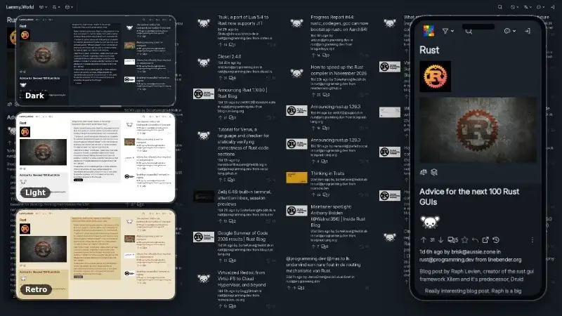

# A.O.S

[](LICENSE)
[](https://www.rust-lang.org/)
[](https://leptos.dev/)
[](https://github.com/tokio-rs/axum)
[](https://daisyui.com/)
[](https://join-lemmy.org/)

[Lemmy services](#lemmy-support) &middot;
[Technical design](#technical-design) &middot;
[Visual and interactive design](#visual-and-interactive-design) &middot;
[Contributing](#contributing)

## A Lemmy client written in Rust, built to be read like a newspaper.

I started A.O.S to explore what a Lemmy client could be if it was designed for reading; minimal UI, content-first, with
featured articles and columns that flowed to infinity so your eyes could browse it like a newspaper instead of the usual
tired old website visual metaphors and mess of clunky controls and screen furniture. Functionality would still be there
and use context to make it powerful and provide feedback, but it would be hidden until you needed it.

A.O.S renders on the server for the fastest time to rendered page possible, hydrates as WebAssembly for instant
interaction, and talks to
whichever Lemmy instance you point it at. Posts and comments flow into columns, your place is remembered, and reading,
navigating and voting all work before a single byte of WebAssembly has loaded.



## Features

- <big>**_Lemmy support across your instance_**</big> - Browse feeds, communities and users. Read threaded comments.
  Vote, save, reply, edit, report and block. Search posts, comments, communities and users in context. Sign in to your
  own account.

- <big>**_Cutting egde Rust architecture_**</big> - One Rust crate compiled for the server (Axum SSR) and the browser
  (WebAssembly). Direct-to-instance API calls, a layered memory and IndexedDB cache, forms that work without JavaScript.

- <big>**_Radically reactive reader-first design_**</big> - A newspaper-column reading surface with sideways scrolling,
  a hero post with its top comment, press-and-hold action bars, collapsible comment threads, three themes, pagination
  state preserved in the URL.

- <big>**_So much more_**</big> - English and French UI translations, offline reading from cache, saved drafts, saved
  scroll
  position, and a blazingly fast feel (of course).

## Lemmy services

### Supported currently

| Object          | Actions                                                                                                                          |
|-----------------|----------------------------------------------------------------------------------------------------------------------------------|
| **Feeds**       | All, Local and Subscribed feeds, sorted by Active, Hot, New, Old, Top, Controversial, Scaled or New Comments. 50 posts per page. |
| **Communities** | Header with icon, banner, description and rules. Subscribe and unsubscribe.                                                      |
| **Posts**       | Full post with body, image, embed description, link host and language.                                                           |
| **Comments**    | 100% Lemmy compatible Markdown. Full threaded tree up to 128 levels deep. Server trimmed children load on demand.                |
| **Voting**      | Upvote and downvote posts and comments, with optimistic updates.                                                                 |
| **Saving**      | Save and unsave posts and comments.                                                                                              |
| **Writing**     | Comment on a post, reply to a comment, edit your own comments. Drafts are kept as you type.                                      |
| **Moderation**  | Report a post with a required reason. Block a user.                                                                              |
| **Search**      | Posts, Comments, Communities and Users, scoped to the whole instance, a community, a user or a single post.                      |
| **Users**       | Profile with avatar, banner and bio. Posts and comments merged into one newest-first activity view, grouped by post.             |
| **Mod log**     | Look up why a comment was removed or its author banned.                                                                          |
| **Accounts**    | Username and password login and logout.                                                                                          |
| **Branding**    | Instance name, icon, description and language list shape the UI. Page titles read `AOS - <instance> - <description>`.            |

### Federation-aware by default

Lemmy is a federated network, and A.O.S shows it openly for ease of identification.

- A.O.S is not tied to one Lemmy server. It starts on `lemmy.world`, and you can switch to any other instance by
  pressing and holding the site name in the top bar, typing a domain, and pressing Enter.
- Community names carry their home instance (`rust@programming.dev`) when the community is not local to the instance you
  are on.
- Author handles show a domain only when it differs from your selected instance.
- Posts that link to another site show the host they came from.
- Federated posts include a link to the original on their home instance.
- Posts that carry a link or an image get a one-tap shortcut to access it archived on archive.ph.
- Each post and comment sets a `lang` attribute from its Lemmy language, which helps screen readers, hyphenation and
  font selection.

### Filters, safety and moderation

- NSFW content is hidden unless you switch it on.
- Posts by authors who are banned from their community are hidden unless you opt in.
- Removed, deleted, banned and blocked comments render as clear placeholders, with a way to look up the mod log or
  reveal blocked content.
- Reports require a reason, and blocking a user is available from the post menu.

## Technical design

### Architecture

A.O.S is a single [Leptos](https://leptos.dev/) crate. The same components, request types and Lemmy API trait run in
both places, so the server-rendered HTML and the hydrated app are built from the same code and stay in step.

### Using Rust, Leptos and standard HTTP to provide a unique experience

1. You open a URL. The server reads your cookies (`instance`, `jwt`, `theme` and the language
   preference).
2. Axum hands the request to Leptos, which renders the route in async SSR mode. The same components fetch from your
   Lemmy instance through `reqwest`.
3. The finished HTML streams back with title, content, theme and language already in place, along with the WebAssembly
   bundle.
4. The bundle hydrates the page. From here on, links, votes and menus act in place, and requests go from the browser
   straight to your instance.
5. Every successful GET is written to memory and IndexedDB, so revisits are instant and survive reloads.

### Where state lives

| Where         | Why                                                                                           | What                                                                                                                                                   |
|---------------|-----------------------------------------------------------------------------------------------|--------------------------------------------------------------------------------------------------------------------------------------------------------|
| **Cookies**   | The server can read them, so the first render already uses your instance, theme and language. | Authentication, instance, theme, and language information.                                                                                             |
| **URL**       | Every view is linkable, and the back button does the right thing.                             | Route, plus the query parameters `list` (All, Local, Subscribed), `sort`, `bans` (NSFW and banned toggles), `kind` (search type) and `page` (cursors). |
| **Memory**    | Instant revisits within a session.                                                            | Five in-memory caches for listings, posts, comments, search and users.                                                                                 |
| **IndexedDB** | Survives reloads. Powers offline reading.                                                     | API responses, scroll positions, collapsed comments, drafts.                                                                                           |

### Pagination you can bookmark

Lemmy paginates with cursors. A.O.S keeps them in the URL as a JSON list of offset and cursor pairs. Filter and sort sit
beside it as JSON-quoted values, for example `/?list="Local"&sort="Hot"&page=[[50,"P3408409"]]`. The
server renders from that chain, so a deep scroll can be reloaded or shared. A set of pages
viewed before will be recreated from the offline cache when you navigate back there.

### Caching and offline

- **Typed request forms are the cache keys**, combined with the login and instance, so one user's data never answers
  another's request.
- **Multipe paged post listing views restored from offline cache**, ensuring that when you navigate back to a page state
  it will be restored as you remember it.
- **When the browser goes offline**, GET requests are answered from IndexedDB. If there is no cached copy, you get a
  warning with a Retry button instead of a blank page.
- **Writes pause** while offline, and resume when the connection returns.
- **A successful vote, save or reply patches the cached post and listing in place**, so the feed you go back to is
  already up to date.

### Progressive enhancement

Menus are `<details>` elements, navigation is real `<a>` links, and actions such as voting, saving, reporting,
blocking and login are server functions behind ordinary forms. They work before WebAssembly loads, and Leptos upgrades
them in place afterwards.
Infinite scroll uses an intersection
observer at the end of the columns and navigates with `replace`, so it never floods your history. Without JavaScript, a
plain Next link takes its place.

### Markdown, errors and i18n

- **Markdown** uses a `pulldown-cmark` fork with strikethrough, tables, superscript, subscript and containers, plus
  Lemmy-style and plain-URL link detection. Raw HTML in content is escaped, never injected.
- **Errors** are typed (`LemmyAppError`), including an explicit offline case. They show as a compact banner with
  expandable details and a retry button.
- **Localisation** uses `leptos_i18n`, with translation keys checked at compile time. English and French ship today, and
  relative times ("15h 53m ago") are localised too.

### Project structure

```text
 src/
 ├── main.rs       Axum SSR service and the client-only entry point
 ├── lib.rs        App shell, routes and HTML template
 ├── prelude.rs    Shared imports, cookies, Markdown, wheel gestures, alerts
 ├── client.rs     LemmyApi helper functions, reqwest on the server, gloo-net in the browser
 ├── db.rs         IndexedDB storage caches
 ├── errors.rs     Typed errors, including the offline case
 ├── nav.rs        Top bar: instance switch, filter, sort, search, theme, language
 ├── overview.rs   Feeds: community header, cursor pagination, infinite scroll
 ├── listing.rs    Post cards
 ├── hero.rs       The expanded first post with its top comment
 ├── toolbar.rs    Vote, save, comment, report, block and archive actions
 ├── post.rs       Post page and comment columns
 ├── comment.rs    Comment tree: folding, press-and-hold actions, drafts
 ├── search.rs     Posts, comments, communities and users, scoped by context
 ├── user.rs       Profiles and activity
 ├── login.rs      Lemmy login
 └── icon.rs       SVG sprite icons
 locales/          English and French translations
 public/           Fonts, icon sprite, favicon and web manifest
 input.css         Tailwind entry point
 build.rs          Compile-time i18n generation
 Cargo.toml        Dependencies, features and Leptos metadata
```

### Deployment

The repository includes a Gitea Actions workflow in `.gitea/workflows/` that builds the release server and site, then
uploads the app files to a remote server over SSH. It then runs a command of your choosing, such as one that starts the
server in the background. The workflow is triggered by a push to the `main` branch.

<details>
<summary>Secrets the workflow expects</summary>

- `SSH_HOST`
- `SSH_PORT`
- `SSH_USER`
- `SSH_KEY`
- `WORK_DIR`
- `SSH_CMD`

The deployment command must start the uploaded binary with the Leptos environment variables set (`LEPTOS_SITE_ROOT` and
`LEPTOS_SITE_ADDR`), and serve `target/site` alongside it.

</details>

## Visual and interactive design

A.O.S treats reading as the primary focus. There is very little chrome: one slim top bar, icon-only toolbars, and menus
that stay folded until you need them. The rest of the screen is content.

### A reading experience built from columns

- **Columns, not an endless scroll.** Content flows into newspaper-like columns that fill top to bottom and then
  continue to the right.
- **The mouse wheel just works.** Vertical wheel input is converted to sideways scrolling, with a small gesture
  classifier that leaves deliberate sideways trackpad swipes to the browser. Text boxes opt out, so scrolling inside a
  reply behaves normally.
- **The next page arrives on its own.** Reaching the end of the columns loads the next page of posts.
- **Your place is remembered.** Scroll position is saved per path and query, and restored when you come back.
- **A hero post.** The first post of a feed opens in full, with its thumbnail, toolbar, body and the top comment
  previewed underneath.
- **On a phone, it is just a feed.** Below the mobile breakpoint the same markup becomes an ordinary vertical page.

### Navigation

The top bar holds everything in a handful of folded menus: feed filter, sort, search scope, content toggles (NSFW and
banned), theme, language and account. Menus are native `<details>` elements, so they work without scripting and close
one another. On small screens the instance name collapses to its icon and search expands to full width. Press and hold
the site name to change instance.

Search is contextual. Open it from a community, a user or a post, and it searches within that context, with the scope
shown in the field.

### Comments you can fold

- **Tap or click** a comment to fold its thread. Open and closed state is saved per post, and selecting text never
  triggers it.
- **Press and hold for half a second**, with a finger or a mouse, to reveal the action bar: vote, save, reply, edit your
  own comments, and highlight everything by one author.
- **A replies badge** loads children that were not in the first response.
- **Left-edge colour** shows status at a glance: the original poster, comments you upvoted and comments you downvoted.
- **Indentation stops at level 8**, and top-level threads alternate background tints, so deep conversations stay legible
  on a narrow screen.
- **Drafts are saved as you type**, for replies, edits and top-level comments, and cleared when you send.
- **Placeholders** for removed, banned, deleted and blocked comments carry their own icon, and some of them can be
  revealed.

### Themes

A.O.S ships `dark`, `light` and `retro` through daisyUI's `data-theme`. The choice is stored in a cookie that the server
reads, so pages are themed from the very first paint. Vote colours follow the theme: secondary is upvote, primary is
downvote, and accent marks saved items and the original poster.

### Feedback

Loading, warning and error states are inline soft alerts in the flow of the page, rather than spinners that block it.
Posts show unread comment counts, and times are compact and localised.

### Features the visual and interactive design makes possible

| Design decision                    | What you get                                                                                                        |
|------------------------------------|---------------------------------------------------------------------------------------------------------------------|
| Newspaper-style columns            | More content per screen, with the next item always beside you, and a sideways scroll that feels like turning pages. |
| Wheel-to-horizontal translation    | Mouse users are not forced to hold Shift, and trackpad users keep native sideways swipes.                           |
| Hero post with top comment         | The conversation starter is readable without leaving the feed.                                                      |
| Press-and-hold action bar          | A clean thread by default, with every action one gesture away on touch and mouse alike.                             |
| Tap to fold, state saved           | Long threads become manageable, and they stay the way you left them.                                                |
| Coloured edges and highlight       | Status and authorship are visible without extra labels, and one commenter can be followed through a thread.         |
| Draft autosave                     | A reply survives a reload, a crash or an accidental tab close.                                                      |
| Cookie-driven themes               | Three looks with no flash of the wrong theme.                                                                       |
| Icon sprite and `em` sizing        | Crisp icons that scale with text size.                                                                              |
| Archive shortcut on external links | One tap to archive a link that may disappear or sit behind a paywall.                                               |

## Roadmap

There are a few fundamentals still to be done, and every one of them is a good place to contribute, but I would like to
continue and extend the unique user experience in their implementation. There are benefits and compromises to the
current
design that can be improved with careful thought and experimentation. The following are some of the next steps:

- Creating posts and communities.
- Multiple accounts and account switching.
- More locales and themes.
- Lemmy API v4.
- Two-factor (TOTP) login.
- An inbox for replies, mentions and private messages. The client layer and an icon are already in place.
- Desktop and mobile packaging. A web manifest is already included.

## Contributing

Contributions are welcome, whether that is code, testing or funding.

Open an issue with reproduction steps (pictures and video really help) or the proposed behaviour before large or
disruptive work. Fork the repository and create a feature branch. Make the smallest focused change that addresses the
task.

## License

Released under the [MIT License](LICENSE).

## AI usage in this app

This project is not "vibe-coded" by AI. However, I have no problem using AI tools to speed up development
as long as all AI suggestions are completely reviewed and tested by a human, and are focussed on
the specific task being implemented. This README page did use LLM output based on the project's human written source and
browser rendering to automate identification of all features. It was, howver, heavily edited after generation.

## Acknowledgements

A.O.S makes extensive use of [Lemmy](https://join-lemmy.org/), [Leptos](https://leptos.dev/),
[leptos-use](https://leptos-use.rs/), [leptos_i18n](https://github.com/Baptistemontan/leptos_i18n),
[Axum](https://github.com/tokio-rs/axum), [Tokio](https://tokio.rs/), [Tailwind CSS](https://tailwindcss.com/),
[daisyUI](https://daisyui.com/), [pulldown-cmark](https://github.com/pulldown-cmark/pulldown-cmark),
[Rexie](https://github.com/SaifAqqad/rexie) and the Adwaita Sans typeface.
